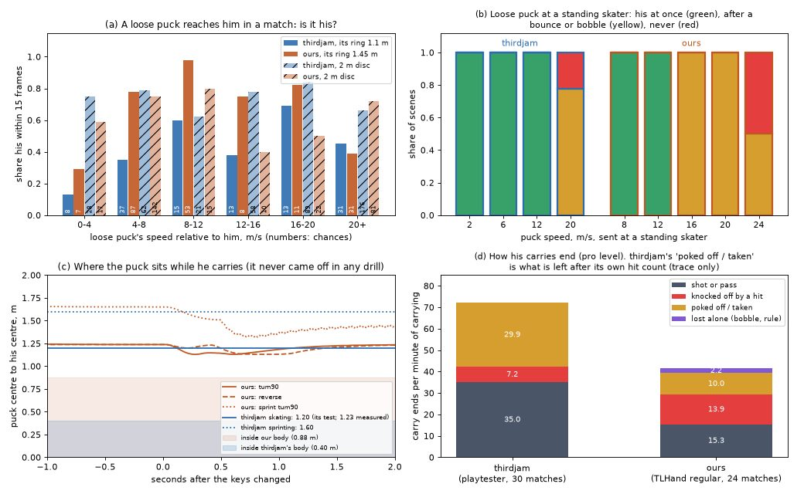

# Hockey behaviour, the player's own body: thirdjam against ours, measured

Lane H1 "hand", day shift of 23 Nov 2026. Research only: nothing in `engine/`, `foreman/`, `contracts/` or `devx/` changed.
**Round 1 (this text): areas 1 and 3, section 0 drafted.** Round 2 adds area 2 (hits and cross-checks) and sections 4 to 6.

**The owner, 23 Nov, after the first teardown (verbatim):** "Hockey - the points you identify plays minority role. You are focused
on visual perspective where as the core of gameplay design is in behavior, which is almost untouched by your analysis. Please do
repeat it - it is about sensitivity of movement (speed, accelaration, deaccelaration), tackles/croschecks and their reactivity, bot
aggressivity and ability to play hockey, openness to sandbox the game (bring weapons, special equipment and boosts), stick control
with puck and ability for puck to stick to players"

This lane has the player's own body: movement, hits, stick and puck. Lane H2 has the bots and the sandbox.

**How to read the numbers.** Time is in frames (60 a second). Distances are in metres and, where it matters, in each game's own
units: a **body width** is the skater's collision circle across (thirdjam 0.80 m, ours 1.76 m: radius 0.40 and 0.879 m,
TEARDOWN 2.2); a **stature** is the drawn figure's height (thirdjam under 1.8 m, ours 4.4 m); the rink is 90 m long in thirdjam
and 60 m in ours.

## How it was measured (the instruments)

Every row of every table below names one of these.

- **[O-drill] Ours, the pack, headless.** A copy of the pack (`.tl/h1/hockey`, never `engine/`) with one test,
  `probes/hand_step.gd`: one skater on empty ice, a set start from the pack's own drills, then the keys held frame by frame
  through the pack's own input path (`ctx.input.set_axis` / `press`, what a key press does; `scripts/player.gd:28-30`), one row
  a frame (position, velocity, facing, puck, who holds it). Scenes: `probes/hand_scenes.mjs`. Measures: `probes/hand_measure.mjs`.
- **[O-window] Ours, in a window.** Six of the same scenes run again in a rendered window (d3d12, movie writer at 60 fps):
  4 of 6 scenes gave byte-identical rows, 2 (with a puck bouncing off the body) differed by at most 0.002 m in the puck's
  position and not at all in who held it when. Clip: `media/beh_window.mp4` (23 s), stills `media/beh_window_sheet.jpg`.
- **[O-match] Ours, matches.** `probes/hand_match.gd`: the ladder's own scripted hand (TLHand "regular", cursor through the hand)
  at pro, 24 seeds, one row a frame for b0, the puck, the holder and the pack's own record of how the puck was released.
- **[T-law] thirdjam, its skating law.** `probes/hand_tj_skate.mjs`: a frame-by-frame port of `UJamSim::StepSkater` of the build
  that ran (`C:/t/t5/Game/Source/JamCore/Private/JamSim.cpp:1266-1478`, the 15 Nov tree the `.tl/tj-run` build was made from),
  free-skater path only, fed the same scene list as ours. thirdjam file:line in this text are in that tree (`C:/t/t5/Game/Source/`). **This is a code integration, not the running game.** It was checked
  against the build itself: the build's own automation tests were run headless on `.tl/tj-run` (`Automation RunTests
  Jam.Core.Movement+...`, 90 tests, 90 Success; log `.tl/h1/auto/auto1.log`) and the port reproduces their printed timings:
  reverse stop from 12.65 m/s still at frame 30 over 2.97 m and 6 m/s back at 45 (build: 30, 2.97, 45); carrier 24 frames, 1.89 m
  (build: 24, 1.89); 0 to 11 m/s in 35 frames with the burst and 56 without (35, 56); first frame at 2 m/s: 6 (6); standing, stick
  behind: 6 m/s that way at frame 42 after drifting 0.075 m the wrong way (42, 0.075); top speeds 12.648 / 14.545 / 10.118 /
  10.927 m/s (the same). One printed number differs by a frame (carrier, 6 m/s back: 44 against 45).
- **[T-test] thirdjam, its own staged tests**, from the same automation run: the possession scenes (`POSSTAGE` lines:
  a loose puck at 2, 6, 12, 20 m/s from the front, side and behind; passes at 8 to 26 m/s; skating over a puck), the carry
  distances (`Jam.Core.Movement.PuckDistance`).
- **[T-match] thirdjam, matches.** Its own tournament commandlet with its human-like playtester as the human
  (`-run=JamTournament -cartridge=hockey.regular -difficulty=pro -player=regular -playersprint -trace=1`, 30 seeds), one TRACE
  line a frame (positions to 0.1 m, the carrier, the last toucher), plus its own per-match counts (`thirdjam.playtest/1` lines).
- **Both match logs are read by one script, `probes/hand_carry.mjs`, with the same rules.** The two hands are different scripted
  hands (thirdjam's playtester, our TLHand): what a hand chooses (when to pass, when to shoot) is the hand's, not the game's.
  Rates that depend on the game (a puck taken from him, a puck coming back to him) are the ones to compare.

**What none of this is:** a person. Neither game was played by a person's hands in this lane. Where a line says "the hand feels",
it is read from the measured response, not from a person.

## 0. The verdict in ten lines (draft of round 1: movement and puck; round 2 adds hits)

1. **In metres the two bodies answer the keys almost alike** (plot below): the first step adds 0.41 m/s a frame in thirdjam and
   0.45 in ours, a 6-frame tap carries 2.5 m and 2.8 m in the next second, a released stick glides at the same 0.15 m/s each second.
   The first teardown was right that the law was ported. It was wrong to stop there: the same law sits on another body.
2. **Speed against his own size: 7.0 statures a second in thirdjam, 2.1 in ours** (12.65 m/s on a figure under 1.8 m; 9.2 m/s on a
   4.4 m figure). In body widths: 15.8 against 5.2 a second. On screen ours moves at about a third of thirdjam's pace.
3. **No build-up in ours:** full speed after 19 frames and 0.8 of a body width; thirdjam takes 34 frames and 4.7 body widths. Ours is
   at its (low) top before the eye sees it start; thirdjam has half a second of push you can feel.
4. **The stop:** stick reversed at top speed, ours is still in 19 frames inside 0.8 of a body width (1.4 m); thirdjam slides 29 to
   30 frames and 3.7 body widths (3.0 m). Ours stops dead; thirdjam's stop carries.
5. **Chasing the man with the puck:** a free skater is 2.5 m/s faster than a carrier in thirdjam (3.6 m/s when both sprint); in ours
   1.1 (1.3). In thirdjam you catch him; in ours you trail him.
6. **The puck is glued in ours:** in play it leaves his stick and comes back by itself 24.8 times a minute of carrying in thirdjam
   and 0.3 times in ours; in all 7 of our carry drills (stops, 90-degree turns, sprint turns) it never once came off. A carry lasts a median
   0.57 s in thirdjam and 1.22 s in ours.
7. **A loose puck becomes his alike** in both below 12 m/s: on the frame it enters his ring. The owner's bar R-0069 ("puck is not
   controlled by player if in his circle area") holds in ours: a still puck within 1.45 m of his centre is his on the first frame at
   every angle (16 of 16 positions), and never at 1.6 m or more. Above 15 m/s ours bobbles (his 11 frames later) where thirdjam
   takes a 12 m/s puck clean and bounces a 20 m/s one.
8. **What takes the puck from him in play** (pro, scripted hands): ours: a hit strips it 13.9 times a minute of carrying and a poke
   10.0; thirdjam: he is knocked down with it 7.2 times a minute, and loses it otherwise about 30 times (trace only, section 3.2).
9. Both move the body on the frame of the key (1 frame). thirdjam's keys are camera-relative (W = away from the camera behind
   you); ours are fixed to the rink under a camera that does not turn with you.
10. Round 2 adds hits and cross-checks (area 2), the behaviour sheet of target numbers (section 4) and the method note (5).

## 1. Movement sensitivity

`media/beh_move.jpg`: speed over time for the same keys frame by frame: from rest; the stick reversed at top speed (the 180);
the stick released; the stick turned 90 degrees; taps of 3, 6 and 12 frames; carrying the puck from rest. Blue thirdjam [T-law],
orange ours [O-drill].

### 1.1 Free skater (no puck), from rest and from top speed

Body widths: thirdjam 0.80 m, ours 1.76 m. Turns and stops act at frame 0 after 150 frames of full stick (both at their top).

| quantity | thirdjam [T-law] | ours [O-drill] | in body widths: thirdjam / ours |
|---|---|---|---|
| top speed, full stick | 12.65 m/s | 9.20 m/s | 15.8 / 5.2 a second |
| the rink end to end at top speed | 7.1 s (90 m) | 6.5 s (60 m) | - |
| first step (burst): speed added a frame | +0.41 m/s | +0.45 m/s | - |
| to 50 % of top | 16 frames, 0.93 m | 11 frames, 0.49 m | 1.2 / 0.3 |
| to 90 % of top | 34 frames, 3.80 m | 19 frames, 1.41 m | 4.7 / 0.8 |
| stick released at top: speed after 1 s | 12.50 m/s (glide 0.147 m/s2) | 9.05 m/s (glide 0.147 m/s2) | - |
| stick released: distance in that second | 12.6 m | 9.1 m | 15.7 / 5.2 |
| stick released: to a stop | about 86 s (never, in play) | about 63 s (never, in play) | - |
| stick reversed (the 180): frames to still | 29-30 | 19 | - |
| stick reversed: distance to still | 2.97 m | 1.39 m | 3.7 / 0.8 |
| stick reversed: 6 m/s the other way | 45 frames | 35 frames | - |
| stick reversed: 90 % of top the other way | 61 frames | 46 frames | - |
| stick 90 degrees: body faces the new way | 19 frames | 21 frames | - |
| stick 90 degrees: travel within 10 degrees of the new way | 50 frames | 53 frames | - |
| stick 90 degrees: peak speed in the turn | 14.45 m/s (+14 %) | 11.64 m/s (+27 %) | - |
| stick 90 degrees: carried on past the turn point | 7.5 m | 6.0 m | 9.3 / 3.4 |
| sprint (Shift held): top | 14.54 m/s (+15 %) | 10.58 m/s (+15 %) | 18.2 / 6.0 |
| sprint from rest: to 90 % of its top | 33 frames | 19 frames | - |
| sprint: bar empties / refills | 180 / 360 frames (code: `JamSim.cpp:1289-1290`) | 180 / 360 frames (`scripts/skate.gd:136-145`) | - |
| sprint held past an empty bar | holds 14.5 m/s: the bar refills a frame and spends it the next (measured: still 14.54 at frame 240) | the same: still 10.58 at frame 240 | - |
| tap 3 frames from rest: peak, distance in the next second | 1.23 m/s, 1.20 m | 1.34 m/s, 1.31 m | 1.5 / 0.7 |
| tap 6 frames | 2.47 m/s, 2.54 m | 2.68 m/s, 2.76 m | 3.2 / 1.6 |
| tap 12 frames | 4.94 m/s, 5.40 m | 5.35 m/s, 5.86 m | 6.8 / 3.3 |
| a tap's glide afterwards | 0.147 m/s2: a 6-frame tap is still moving at 2.3 m/s after 1.5 s | the same 0.147 m/s2 | - |
| key to first motion | 1 frame (the press frame moves the body) | 1 frame (the same) [O-drill, O-window] | - |
| what the move keys mean | camera-relative: W away from the camera behind you; S held keeps the direction of the moment it was pressed (`HokejGameMode.cpp:929-955`) | fixed to the rink (`scripts/player.gd:28-30`) | - |

### 1.2 The puck carrier

| quantity | thirdjam [T-law] | ours [O-drill] | in body widths: thirdjam / ours |
|---|---|---|---|
| carrier top speed | 10.12 m/s (0.80 of a free skater) | 8.09 m/s (0.88 of a free skater) | 12.6 / 4.6 a second |
| carrier sprinting | 10.93 m/s (build: 10.9272) | 9.31 m/s | 13.7 / 5.3 |
| a free skater gains on a carrier: both gliding / both sprinting | 2.5 / 3.6 m/s | 1.1 / 1.3 m/s | 3.2 / 0.6 a second (gliding) |
| to 90 % of top | 34 frames, 3.04 m | 21 frames, 1.37 m | 3.8 / 0.8 |
| stick reversed: frames, distance to still | 23-24, 1.89 m (build: 24, 1.89) | 17, 1.12 m | 2.4 / 0.6 |
| stick 90 degrees: travel in the new way | 50 frames, carried on 6.0 m | 56 frames, carried on 5.6 m | 7.5 / 3.2 |
| tap 6 frames: peak, distance in a second | 1.97 m/s, 2.01 m | 2.14 m/s, 2.19 m | 2.5 / 1.2 |

### 1.3 What the hand feels

- **The same push, a much larger body.** Per frame and per metre the keys give back what thirdjam's give. But the figure is 2.2
  times as large and its top speed 27 % lower, so measured against itself ours moves at a third of thirdjam's pace: 5.2 body widths
  a second against 15.8, 2.1 statures against 7.0. A person judges speed against the figure, not against metres: ours reads as a walk.
- **No acceleration to feel.** Ours is at 90 % of its top after 19 frames, before it has moved one body width. There is no
  "wind-up" to the speed; the skater is either standing or at a fixed cruise. thirdjam's half-second of build-up over almost five body
  widths is the part of skating a hand feels as weight and momentum.
- **Stops are dead stops.** Ours stops in under one body width; thirdjam's stop slides almost four. Both release the stick into a
  glide that never ends (the same ice friction), so both need the reverse to stop.
- **Placing yourself.** A 6-frame tap moves ours 1.6 of its body widths and thirdjam's 3.2. Ours places finer against its own size,
  but in metres the two are within 10 %: on a rink of 60 m the fine placing buys little, and the tap keeps gliding in both.
- **Turns.** In metres the turns match (facing in 19 against 21 frames, travel in the new way in 50 against 53). Ours gains 27 % of
  speed in a 90-degree turn (thirdjam 14 %): the push along the new facing adds to the old sideways slide before the grip takes it.
- **The carrier is nearly as fast as you.** In thirdjam a defender closes 2.5 m/s on a gliding carrier, 3.2 of his body widths a
  second; in ours 1.1 m/s, 0.6 of a body width a second: a chase the length of the rink gains about 8 m.

### 1.4 Why ours does this (file:line)

- **Top speed 9.2 against 12.65 m/s:** `data/tuning.json:4` `skate_speed` 8 times `free_speed_mult` 1.15 (`data/tuning.json:6`);
  thirdjam ships 11 x 1.15 (`hockey.regular.cartridge.json` `game.skater.speed` 11; `JamSim.cpp:1337`). L4 ported thirdjam's ratios
  onto the schema's base speed 8 (TEARDOWN 2.3).
- **The size:** `data/tuning.json:4` `body_scale` 2.2 and `:5` `contact_body_scale` 2.93 (radius 0.879 m). No speed was scaled with
  the body when it grew (TEARDOWN 2.2: the scale came from a drawing fix on 16 Nov).
- **Same push, smaller top, so full speed sooner:** thrust `skate_accel` 13 x 1.15 = 14.95 m/s2 (`data/tuning.json:4`, `scripts/skate.gd:190`)
  against thirdjam's 12 x 1.15 = 13.8; the kernel adds thrust only below `skate_speed` (`engine/kernel/api/tl_biped.gd:521-522`), so
  the same push fills a top 27 % lower in 19 frames instead of 34.
- **The dead stop:** the same reverse law as thirdjam (`scripts/skate.gd:221-231`, `reverse_decel` 26, `data/tuning.json:8`;
  `JamSim.cpp:1397-1417`): 26 m/s2 from 9.2 m/s is 21 frames, from 12.65 it is 29. The law is the same; the speed it stops from is not.
- **The turn's extra speed:** `engine/kernel/api/tl_biped.gd:520-527`: thrust along the new facing while the sideways part decays at
  `skate_lateral_grip` 3 a second, the same grip as thirdjam's; relative to a lower top the overshoot is larger.
- **The carrier's small penalty:** `scripts/skate.gd:156-159` gives the carrier `carry_speed_scale` 1.012 (`data/tuning.json:18`) and
  no free-skater bonus, so 8 x 1.012 = 8.09 against 9.2 (x 0.88); thirdjam's carrier is x 0.92 of the base and the free skater
  x 1.15 (`JamSim.cpp:1284, 1336-1337`): x 0.80.
- **The sprint that never runs out while held** is thirdjam's own rule, ported line for line (`scripts/skate.gd:136-145`;
  `JamSim.cpp:1289-1290`): a frame without stamina refills 180 ticks, the next frame spends 360. Both games share it.
- **Keys:** `scripts/player.gd:28-30` reads the four keys as rink directions; thirdjam turns them by the camera's yaw
  (`HokejGameMode.cpp:935-955`). Not measured in either window in this round.

## 2. Tackles and cross-checks, and their reactivity

Round 2.

## 3. Stick control with the puck, and the puck sticking to players

`media/beh_puck.jpg`: (a) in matches, a loose puck reaching him: his within 15 frames, by its speed relative to him, at each
game's own ring and at a common 2 m disc [T-match, O-match]; (b) a loose puck sent at a standing skater: his at once, after a
bounce or bobble, or never [T-test, O-drill]; (c) where the puck sits while he carries through a 90-degree turn, a stop and a
sprint turn [O-drill], with thirdjam's measured carry distances [T-test]; (d) how his carries end in matches [T-match, O-match].

### 3.1 How a loose puck becomes his

| quantity | thirdjam | ours |
|---|---|---|
| the take ring (puck centre to body centre) | 1.1 m for the human; a stick arc 1.5 m; the body (code: `JamSim.cpp:3675-3730` TryLoosePickup, `3919-3952` BodyMeetsPuck; TEARDOWN 2.4) | 1.45 m (`data/tuning.json:11` `reach`; `scripts/carry.gd:183-222`) |
| ... in his own size | 1.4 body widths from his centre: 0.7 m beyond his edge | 0.8 body widths: 0.57 m beyond his edge |
| R-0069: a still puck inside the ring, he stands and presses nothing | his on the frame it is inside (`POSSTAGE ... rule: inside 0` in all 59 staged scenes [T-test]) | his on the first frame at 0.6, 0.9, 1.2 and 1.4 m, at 0, 90, 180 and 270 degrees: 16 of 16; never at 1.6 and 1.9 m: 0 of 8 [O-drill] |
| loose puck sent at him standing, below 12 m/s | his, no bounce: 27 of 27 scenes (2, 6 and 12 m/s; front, side, behind) [T-test] | his on the frame after it enters the ring: 12 of 12 (8 and 12 m/s; front, side, behind; centre and 0.8 m off) [O-drill] |
| ... at 16 m/s | not staged | bobble, then his 11 frames later: 6 of 6 [O-drill] |
| ... at 20 m/s | bounces off him, then his (by frame 5-8 of the scene): 7 of 9; never 2 of 9 [T-test] | bobble, then his 11 frames later: 6 of 6 [O-drill] |
| ... at 24 m/s | not staged (shots at 25 and 35 m/s: bounce) | aimed at his centre: off his body, then his (3 of 3); 0.8 m off: goes past (0 of 3) [O-drill] |
| skating onto a still puck, glide speed 2 to 12 m/s | his at walk, glide and sprint, 0, 0.3 and 0.8 m beside his line: 9 of 9 [T-test] | his at 2, 4, 6, 8, 10 and 12 m/s, up to 1.2 m beside his line: 30 of 30, 1 frame after it enters the ring; 1.8 m beside: 0 of 12 [O-drill] |
| a pass to him, standing | 8, 14, 20 and 26 m/s at his feet, skates, or 1 m off his stick: his, never a bounce (12 of 12) [T-test] | 18 m/s (`recv_line`), 23 m/s (`recv_hard`) and 27 m/s (`recv_clean_hard`): his, at 2.05 m from his centre (ring + 0.6 m for a pass meant for him, `scripts/carry.gd:132-135`) [O-drill] |
| in matches: a loose puck enters his own ring: his within 15 frames | 13 % (0-4 m/s), 35 % (4-8), 60 % (8-12), 38 % (12-16), 69 % (16-20), 45 % (20+); 117 chances, 47 taken by someone else first [T-match] | 29 %, 78 %, 98 %, 75 %, 82 %, 39 %; 197 chances, 14 taken by someone else first [O-match] |
| ... at a common 2 m disc | 75 %, 79 %, 62 %, 78 %, 84 %, 66 % (434 chances) [T-match] | 59 %, 75 %, 80 %, 40 %, 50 %, 72 % (287 chances) [O-match] |
| frames from entering the ring to his (matches, median) | 2-5 | 1 below 16 m/s, 11 at 16-20 (the bobble), 4 above 20 |

### 3.2 While he carries: where the puck sits, and what takes it off

| quantity | thirdjam | ours |
|---|---|---|
| puck centre to his centre, skating, as played (with a cursor) | 1.20 m (build test: blade 1.200, puck 1.229 [T-test]; matches: median 1.20, 10-90 % 0.81-1.34 m [T-match]) | median 1.93 m, 10-90 % 1.58-1.98 m [O-match] (with no cursor: 1.24 m [O-drill]) |
| ... in his own size | 1.5 body widths from his centre: 0.8 m beyond his edge | 1.1 body widths: 1.05 m beyond his edge |
| sprinting | 1.60 m (build test) | 1.65 m with no cursor, 2.64 m with one (`tests/bot_carry_turn.gd` notes) [O-drill] |
| through a 90-degree turn, a reversal (the 180), a sprint turn | follows the blade at the carry distance (test: 0 of 120 frames not carried) [T-test] | stays 1.13-1.36 m (turn, stop) and 1.27-1.79 m (sprint turn) from his centre; held in every frame of all 7 carry scenes [O-drill] |
| the puck leaves his stick and comes back by itself (inside 20 frames, nobody else touched it) | 24.8 times a minute of carrying (338 in 13.6 min) [T-match] | 0.3 times (2 in 6.5 min) [O-match] |
| a carry lasts (blips folded in): median, 90 % | 0.57 s, 2.2 s [T-match] | 1.22 s, 3.2 s [O-match] |
| share of live play he carries | 16.4 % | 15.3 % |
| carry ends by his own shot or pass, a minute of carrying | 35.0 (playtester's own counts: 300 passes, 200 shots in 14.3 min) | 15.3 (72 shots, 27 passes) |
| ... he is hit and loses it | knocked down with it: 7.2 (31 + 72 knockdowns as he won it or carried it, its own counts) | stripped by a hit: 13.9 (90 releases of kind `hit`) |
| ... a stick or a touch takes it | about 30: 37.1 taken or lost (trace) less the 7.2 knockdowns; the trace cannot tell a poke from a touch | poked: 10.0 (65 releases of kind `poked`) |
| ... lost on his own (a bobble, a rule) | not separable in the trace | 2.2 (14) |

Hands differ: thirdjam's playtester passes and shoots twice as often a minute of carrying as our TLHand; its counts of what it
chose are the hand's. The two rows that are the game's are the puck coming back to him (24.8 against 0.3) and how often the
puck is taken from him (thirdjam more often, read from a 0.1 m trace and not split by cause).

### 3.3 How the stick moves the puck

Measured in this round only through the cursor's effect on the carry distance (1.24 m without a cursor, 1.93 m median with
the hand's cursor, above). From the code, not measured: thirdjam has a deke (wheel / Y: the puck to one side for a few frames), a
spin (E: the puck to the far side of the body, a shield) and a sweep (the puck follows the aim across the body), each with its own
tests: from 6 m against a pro defender the cut alone gets past 35.5 % of 200 tries, the deke with the cut 48.0 %, the spin with
the cut 48.5 % (`LATE` lines of the build's tests [T-test]). Ours has the cursor-driven blade (`scripts/carry.gd:84-89`), a dangle
of up to 0.82 m outward in a turn (`scripts/carry.gd:111`), and a loss rule only for a sprinting carrier in a hard turn
(`scripts/carry.gd:113-117`); no deke or spin key. Round 2 measures the cursor sweep and the dangle in both.

### 3.4 What the hand feels

- **The puck is part of the body in ours.** Once his, it rides a spring to the blade and nothing he does with the keys moves it
  off: not a dead stop, not a 90-degree turn, not a sprint turn. In thirdjam the puck leaves the stick and returns 25 times a minute
  of carrying: it is a thing you handle. The owner's "puck stickiness" complaint (21 Nov) and "puck to stick to players" are this:
  ours sticks completely.
- **Taking a loose puck is alike, and R-0069 holds.** Below 12 m/s both games give the puck to the man who reaches it, on the first
  frame. Ours differs only in fast pucks: a 16-20 m/s loose puck bobbles for 11 frames in ours where thirdjam bounces it off the body.
- **Ours carries it farther out in metres, closer in body size.** With a cursor the puck sits 1.93 m from his centre, a metre beyond
  his edge (thirdjam 1.2 m, 0.8 m beyond): a defender's stick reaches it sooner in metres, and a poke takes it 10 times a minute of
  carrying; a hit strips it 13.9 times.

### 3.5 Why ours does this (file:line)

- **Glued:** `scripts/carry.gd:120-125` holds the puck on a critically damped spring (`spring_k` 400, `data/tuning.json:12`) to the
  drawn blade each frame; the only ways off are a release (pass, shot, poke, hit: `scripts/rink_api.gd`, `scripts/poke.gd`,
  `scripts/hits.gd`) or a sprinting carrier past 0.9 of the dangle for 6 frames (`scripts/carry.gd:113-117`, `data/tuning.json:12`
  `loss_ratio`, `loss_frames`). thirdjam's carried puck is the sim's own puck pulled 25 % a substep toward the blade (its carry
  assist, `JamSim.cpp` StepPuck; TEARDOWN 2.4) and can leave the stick's reach in a turn or a sprint.
- **The take:** `scripts/carry.gd:183-222`: nearest skater within `reach` 1.45 m of the puck's path this frame, clean below
  `clean_speed` 15 m/s relative, a bobble from 15 to `bobble_speed` 20 (his after `bobble_frames` 10), through above 20 unless the
  pass was meant for him (`recv_bobble_speed` 28, ring + `recv_extra` 0.6 m) (`data/tuning.json:11-14`).
- **The carry distance:** `scripts/carry.gd:84-89`: `blade_base` 0.66 + `blade_reach` 1.98 at full aim (half without a cursor), x
  `carry_reach_mult` 0.75 unless sprinting (`data/tuning.json:11`); L4 scaled thirdjam's rule to the 2.2x figure (`tests/bot_carry_turn.gd:2-5`).

## 4. The behaviour sheet for our hockey

Round 2.

## 5. What a design must measure before a build

Round 2.

## 6. What this could not see, and the evidence index (round 1 part)

Could not see in round 1:
- **A person's hands.** Every number here is a scripted hand's. The owner plays this evening; his hand is the bar.
- **thirdjam's body in a window.** Its skating was measured on a port of its law, checked against its own automation tests (the
  real sim of the build, headless), not filmed. Its camera-relative keys were not measured: the 90-degree turn above is a turn of the
  stick on the ice, which in thirdjam a person makes by turning the camera with A or D.
- **Screen speed.** "About a third of thirdjam's pace on screen" is from statures a second, not measured on screen.
- **The cursor's sweep, dekes and the spin** (3.3) are from code and thirdjam's test lines; round 2 measures them.
- **Match rates depend on the hand** (3.2): thirdjam's playtester and our TLHand choose differently.

Evidence (all under `.tl/h1/` in this worktree unless named):
- Instruments (committed): `probes/hand_step.gd` and `probes/hand_match.gd` (each with a hand-written `.gd.uid`: arch rule 3 wants one for every .gd; these scripts run only when copied into a pack copy's `tests/`), `probes/hand_scenes.mjs`, `probes/hand_measure.mjs`, `probes/hand_tj_skate.mjs`,
  `probes/hand_match.gd`, `probes/hand_carry.mjs`, `probes/hand_plot.py`.
- Our step responses: `ours_move/*.csv` (15 scenes), `ours_pick/*.csv` (78), `ours_ring/*.csv` (24), `ours_recv/*.csv` (8);
  windowed run `win/*.csv`, `win/win.avi`; measures `measure_move.json`.
- thirdjam: port curves `tj_move/*.csv`; automation log `auto/auto1.log` (90 of 90 Success; `TIMING`, `POSSTAGE`, `full aim`,
  `LATE` lines); tournament traces `tour/pro_regular30.log` (30 seeds) and `tour/pro_regular.log` (8).
- Match reads: `carry_ours.json`, `carry_tj.json` (own rings), `carry_ours2.0.json`, `carry_tj2.0.json` (2 m disc); our 24 match
  logs `ours_match/match_s*.csv`.
- To run again: `node probes/hand_scenes.mjs <pack copy> <out>`; `.tl/h1/run_step.sh <scenes.json> <out>`;
  `node probes/hand_tj_skate.mjs --scenes <scenes.json> <out>`; `node probes/hand_measure.mjs <ours> <tj>`;
  `.tl/h1/run_match.sh pro regular 24 <out>`; `node probes/hand_carry.mjs ours <out>` / `tj <trace log> [disc m]`;
  `python probes/hand_plot.py .tl/h1 media`.
