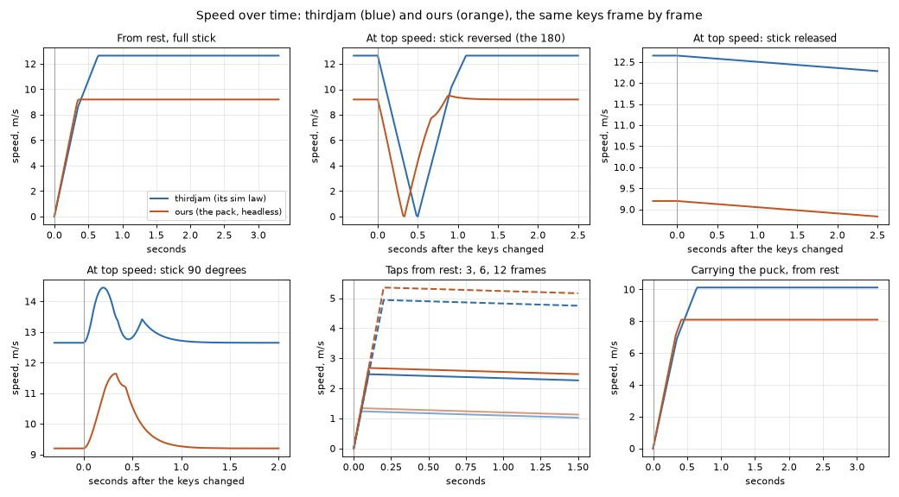
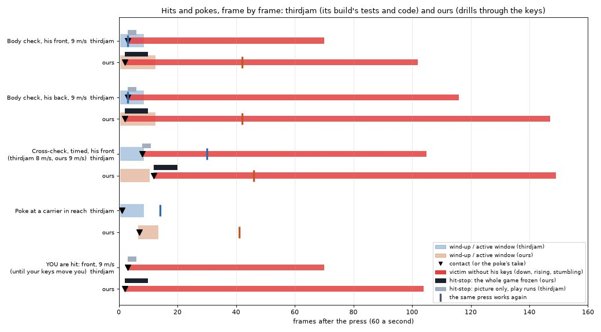

# Hockey behaviour, the player's own body: thirdjam against ours, measured

Lane H1 "hand", day shift of 23 Nov 2026. Research only: nothing in `engine/`, `foreman/`, `contracts/` or `devx/` changed.
Round 1 (landed 23 Nov, merge 5d07c50): areas 1 and 3. Round 2 (this text): area 2 (hits, cross-checks, pokes), the behaviour sheet (section 4), the method proposal (5), what could not be seen (6), and section 0 with the hits.

**The owner, 23 Nov, after the first teardown (verbatim):** "Hockey - the points you identify plays minority role. You are focused
on visual perspective where as the core of gameplay design is in behavior, which is almost untouched by your analysis. Please do
repeat it - it is about sensitivity of movement (speed, accelaration, deaccelaration), tackles/croschecks and their reactivity, bot
aggressivity and ability to play hockey, openness to sandbox the game (bring weapons, special equipment and boosts), stick control
with puck and ability for puck to stick to players"

This lane has the player's own body: movement, hits, stick and puck. Lane H2 has the bots and the sandbox.

**How to read the numbers.** Time is in frames (60 a second). Distances are in metres and, where it matters, in each game's own
units: a **body width** is the skater's collision circle across (thirdjam 0.80 m, ours 1.76 m: radius 0.40 and 0.879 m,
TEARDOWN 2.2); a **stature** is the drawn figure's height (thirdjam under 1.8 m, ours 4.4 m); the rink is 90 m long in thirdjam
and 60 m in ours.

## How it was measured (the instruments)

Every row of every table below names one of these.

- **[O-drill] Ours, the pack, headless.** A copy of the pack (`.tl/h1/hockey`, never `engine/`) with one test,
  `probes/hand_step.gd`: one skater on empty ice, a set start from the pack's own drills, then the keys held frame by frame
  through the pack's own input path (`ctx.input.set_axis` / `press`, what a key press does; `scripts/player.gd:28-30`), one row
  a frame (position, velocity, facing, puck, who holds it). Scenes: `probes/hand_scenes.mjs`. Measures: `probes/hand_measure.mjs`.
- **[O-window] Ours, in a window.** Six of the same scenes run again in a rendered window (d3d12, movie writer at 60 fps):
  4 of 6 scenes gave byte-identical rows, 2 (with a puck bouncing off the body) differed by at most 0.002 m in the puck's
  position and not at all in who held it when. Clip: `media/beh_window.mp4` (23 s), stills `media/beh_window_sheet.jpg`.
- **[O-match] Ours, matches.** `probes/hand_match.gd`: the ladder's own scripted hand (TLHand "regular", cursor through the hand)
  at pro, 24 seeds, one row a frame for b0, the puck, the holder and the pack's own record of how the puck was released.
- **[T-law] thirdjam, its skating law.** `probes/hand_tj_skate.mjs`: a frame-by-frame port of `UJamSim::StepSkater` of the build
  that ran (`C:/t/t5/Game/Source/JamCore/Private/JamSim.cpp:1266-1478`, the 15 Nov tree the `.tl/tj-run` build was made from),
  free-skater path only, fed the same scene list as ours. thirdjam file:line in this text are in that tree (`C:/t/t5/Game/Source/`). **This is a code integration, not the running game.** It was checked
  against the build itself: the build's own automation tests were run headless on `.tl/tj-run` (`Automation RunTests
  Jam.Core.Movement+...`, 90 tests, 90 Success; log `.tl/h1/auto/auto1.log`) and the port reproduces their printed timings:
  reverse stop from 12.65 m/s still at frame 30 over 2.97 m and 6 m/s back at 45 (build: 30, 2.97, 45); carrier 24 frames, 1.89 m
  (build: 24, 1.89); 0 to 11 m/s in 35 frames with the burst and 56 without (35, 56); first frame at 2 m/s: 6 (6); standing, stick
  behind: 6 m/s that way at frame 42 after drifting 0.075 m the wrong way (42, 0.075); top speeds 12.648 / 14.545 / 10.118 /
  10.927 m/s (the same). One printed number differs by a frame (carrier, 6 m/s back: 44 against 45).
- **[T-test] thirdjam, its own staged tests**, from the same automation run: the possession scenes (`POSSTAGE` lines:
  a loose puck at 2, 6, 12, 20 m/s from the front, side and behind; passes at 8 to 26 m/s; skating over a puck), the carry
  distances (`Jam.Core.Movement.PuckDistance`).
- **[T-match] thirdjam, matches.** Its own tournament commandlet with its human-like playtester as the human
  (`-run=JamTournament -cartridge=hockey.regular -difficulty=pro -player=regular -playersprint -trace=1`, 30 seeds), one TRACE
  line a frame (positions to 0.1 m, the carrier, the last toucher), plus its own per-match counts (`thirdjam.playtest/1` lines).
- **Both match logs are read by one script, `probes/hand_carry.mjs`, with the same rules.** The two hands are different scripted
  hands (thirdjam's playtester, our TLHand): what a hand chooses (when to pass, when to shoot) is the hand's, not the game's.
  Rates that depend on the game (a puck taken from him, a puck coming back to him) are the ones to compare.

**What none of this is:** a person. Neither game was played by a person's hands in this lane. Where a line says "the hand feels",
it is read from the measured response, not from a person.

## 0. The verdict in ten lines

1. **In metres the two games answer alike**: the first step adds 0.41 m/s a frame in thirdjam and 0.45 in ours, a 6-frame tap
   carries 2.5 and 2.8 m, and a hit's outcome is the same law to three digits (a standing man hit from the front at 9 m/s: ratio
   1.17, down 67 against 68 frames). The first teardown was right that the laws were ported, and wrong to stop there.
2. **Speed against his own size: 15.8 body widths a second in thirdjam, 5.2 in ours** (12.65 m/s on a 0.8 m body; 9.2 m/s on
   1.76 m). Our figure reads as a jog whatever it does; the rink is crossed in the same time (7.1 against 6.5 s).
3. **No build-up and a dead stop:** ours is at 90 % of top after 19 frames and 0.8 of a body width (thirdjam 34 frames, 4.7);
   reversed at top it is still after 19 frames and 0.8 of a body width (thirdjam 29-30 frames, 3.7).
4. **The man with the puck is nearly as fast as you:** a free skater gains 2.5 m/s on him in thirdjam, 1.1 in ours.
5. **The puck is glued:** it leaves his stick and comes back by itself 24.8 times a minute of carrying in thirdjam, 0.3 in ours.
   Picking a loose puck up is alike, and the owner's R-0069 holds in ours (16 of 16 still pucks in the ring his on frame 1).
6. **A hit takes your hand away longer:** knocked down from the front at 9 m/s, your keys move you again at frame 104 in ours,
   frame 70 in thirdjam (ours adds a 24-frame rise and an 8-frame freeze of the whole game).
7. **The whole game freezes about four times a minute** (5-9 frames on any hit of 5 m/s or more near you); thirdjam holds the
   picture 3 frames on a knockdown that involves you, and play runs.
8. **Bodies are walls in ours:** skate into a man without a press and you stop dead (9 to 0 m/s) and he does not move; in
   thirdjam he is pushed off at 4.3 m/s and you keep 2.5.
9. **Our hits are slow and our poke is luck:** wind-ups 12 / 10 frames against 8 / 8; the same press again after 42 (check),
   46 (cross), 41 (poke) frames against none, 30, 14; a cross pressed within 10 frames of the meeting only pushes; the poke takes
   the puck 14 / 7 times in 20 (front / side) and sends it away, where thirdjam's takes it every time and rolls it to you.
10. **The sheet (section 4):** 19 rows that hold whatever the size (mostly data), then a size route: A keeps our body and
    matches thirdjam's clock, B goes life-size on 90 x 45 with thirdjam's numbers. I would build the 19 rows now and choose B.

## 1. Movement sensitivity

`media/beh_move.jpg`: speed over time for the same keys frame by frame: from rest; the stick reversed at top speed (the 180);
the stick released; the stick turned 90 degrees; taps of 3, 6 and 12 frames; carrying the puck from rest. Blue thirdjam [T-law],
orange ours [O-drill].

### 1.1 Free skater (no puck), from rest and from top speed

Body widths: thirdjam 0.80 m, ours 1.76 m. Turns and stops act at frame 0 after 150 frames of full stick (both at their top).

| quantity | thirdjam [T-law] | ours [O-drill] | in body widths: thirdjam / ours |
|---|---|---|---|
| top speed, full stick | 12.65 m/s | 9.20 m/s | 15.8 / 5.2 a second |
| the rink end to end at top speed | 7.1 s (90 m) | 6.5 s (60 m) | - |
| first step (burst): speed added a frame | +0.41 m/s | +0.45 m/s | - |
| to 50 % of top | 16 frames, 0.93 m | 11 frames, 0.49 m | 1.2 / 0.3 |
| to 90 % of top | 34 frames, 3.80 m | 19 frames, 1.41 m | 4.7 / 0.8 |
| stick released at top: speed after 1 s | 12.50 m/s (glide 0.147 m/s2) | 9.05 m/s (glide 0.147 m/s2) | - |
| stick released: distance in that second | 12.6 m | 9.1 m | 15.7 / 5.2 |
| stick released: to a stop | about 86 s (never, in play) | about 63 s (never, in play) | - |
| stick reversed (the 180): frames to still | 29-30 | 19 | - |
| stick reversed: distance to still | 2.97 m | 1.39 m | 3.7 / 0.8 |
| stick reversed: 6 m/s the other way | 45 frames | 35 frames | - |
| stick reversed: 90 % of top the other way | 61 frames | 46 frames | - |
| stick 90 degrees: body faces the new way | 19 frames | 21 frames | - |
| stick 90 degrees: travel within 10 degrees of the new way | 50 frames | 53 frames | - |
| stick 90 degrees: peak speed in the turn | 14.45 m/s (+14 %) | 11.64 m/s (+27 %) | - |
| stick 90 degrees: carried on past the turn point | 7.5 m | 6.0 m | 9.3 / 3.4 |
| sprint (Shift held): top | 14.54 m/s (+15 %) | 10.58 m/s (+15 %) | 18.2 / 6.0 |
| sprint from rest: to 90 % of its top | 33 frames | 19 frames | - |
| sprint: bar empties / refills | 180 / 360 frames (code: `JamSim.cpp:1289-1290`) | 180 / 360 frames (`scripts/skate.gd:136-145`) | - |
| sprint held past an empty bar | holds 14.5 m/s: the bar refills a frame and spends it the next (measured: still 14.54 at frame 240) | the same: still 10.58 at frame 240 | - |
| tap 3 frames from rest: peak, distance in the next second | 1.23 m/s, 1.20 m | 1.34 m/s, 1.31 m | 1.5 / 0.7 |
| tap 6 frames | 2.47 m/s, 2.54 m | 2.68 m/s, 2.76 m | 3.2 / 1.6 |
| tap 12 frames | 4.94 m/s, 5.40 m | 5.35 m/s, 5.86 m | 6.8 / 3.3 |
| a tap's glide afterwards | 0.147 m/s2: a 6-frame tap is still moving at 2.3 m/s after 1.5 s | the same 0.147 m/s2 | - |
| key to first motion | 1 frame (the press frame moves the body) | 1 frame (the same) [O-drill, O-window] | - |
| what the move keys mean | camera-relative: W away from the camera behind you; S held keeps the direction of the moment it was pressed (`HokejGameMode.cpp:929-955`) | fixed to the rink (`scripts/player.gd:28-30`) | - |

### 1.2 The puck carrier

| quantity | thirdjam [T-law] | ours [O-drill] | in body widths: thirdjam / ours |
|---|---|---|---|
| carrier top speed | 10.12 m/s (0.80 of a free skater) | 8.09 m/s (0.88 of a free skater) | 12.6 / 4.6 a second |
| carrier sprinting | 10.93 m/s (build: 10.9272) | 9.31 m/s | 13.7 / 5.3 |
| a free skater gains on a carrier: both gliding / both sprinting | 2.5 / 3.6 m/s | 1.1 / 1.3 m/s | 3.2 / 0.6 a second (gliding) |
| to 90 % of top | 34 frames, 3.04 m | 21 frames, 1.37 m | 3.8 / 0.8 |
| stick reversed: frames, distance to still | 23-24, 1.89 m (build: 24, 1.89) | 17, 1.12 m | 2.4 / 0.6 |
| stick 90 degrees: travel in the new way | 50 frames, carried on 6.0 m | 56 frames, carried on 5.6 m | 7.5 / 3.2 |
| tap 6 frames: peak, distance in a second | 1.97 m/s, 2.01 m | 2.14 m/s, 2.19 m | 2.5 / 1.2 |

### 1.3 What the hand feels

- **The same push, a much larger body.** Per frame and per metre the keys give back what thirdjam's give. But the figure is 2.2
  times as large and its top speed 27 % lower, so measured against itself ours moves at a third of thirdjam's pace: 5.2 body widths
  a second against 15.8, 2.1 statures against 7.0. A person judges speed against the figure, not against metres: ours reads as a walk.
- **No acceleration to feel.** Ours is at 90 % of its top after 19 frames, before it has moved one body width. There is no
  "wind-up" to the speed; the skater is either standing or at a fixed cruise. thirdjam's half-second of build-up over almost five body
  widths is the part of skating a hand feels as weight and momentum.
- **Stops are dead stops.** Ours stops in under one body width; thirdjam's stop slides almost four. Both release the stick into a
  glide that never ends (the same ice friction), so both need the reverse to stop.
- **Placing yourself.** A 6-frame tap moves ours 1.6 of its body widths and thirdjam's 3.2. Ours places finer against its own size,
  but in metres the two are within 10 %: on a rink of 60 m the fine placing buys little, and the tap keeps gliding in both.
- **Turns.** In metres the turns match (facing in 19 against 21 frames, travel in the new way in 50 against 53). Ours gains 27 % of
  speed in a 90-degree turn (thirdjam 14 %): the push along the new facing adds to the old sideways slide before the grip takes it.
- **The carrier is nearly as fast as you.** In thirdjam a defender closes 2.5 m/s on a gliding carrier, 3.2 of his body widths a
  second; in ours 1.1 m/s, 0.6 of a body width a second: a chase the length of the rink gains about 8 m.

### 1.4 Why ours does this (file:line)

- **Top speed 9.2 against 12.65 m/s:** `data/tuning.json:4` `skate_speed` 8 times `free_speed_mult` 1.15 (`data/tuning.json:6`);
  thirdjam ships 11 x 1.15 (`hockey.regular.cartridge.json` `game.skater.speed` 11; `JamSim.cpp:1337`). L4 ported thirdjam's ratios
  onto the schema's base speed 8 (TEARDOWN 2.3).
- **The size:** `data/tuning.json:4` `body_scale` 2.2 and `:5` `contact_body_scale` 2.93 (radius 0.879 m). No speed was scaled with
  the body when it grew (TEARDOWN 2.2: the scale came from a drawing fix on 16 Nov).
- **Same push, smaller top, so full speed sooner:** thrust `skate_accel` 13 x 1.15 = 14.95 m/s2 (`data/tuning.json:4`, `scripts/skate.gd:190`)
  against thirdjam's 12 x 1.15 = 13.8; the kernel adds thrust only below `skate_speed` (`engine/kernel/api/tl_biped.gd:521-522`), so
  the same push fills a top 27 % lower in 19 frames instead of 34.
- **The dead stop:** the same reverse law as thirdjam (`scripts/skate.gd:221-231`, `reverse_decel` 26, `data/tuning.json:8`;
  `JamSim.cpp:1397-1417`): 26 m/s2 from 9.2 m/s is 21 frames, from 12.65 it is 29. The law is the same; the speed it stops from is not.
- **The turn's extra speed:** `engine/kernel/api/tl_biped.gd:520-527`: thrust along the new facing while the sideways part decays at
  `skate_lateral_grip` 3 a second, the same grip as thirdjam's; relative to a lower top the overshoot is larger.
- **The carrier's small penalty:** `scripts/skate.gd:156-159` gives the carrier `carry_speed_scale` 1.012 (`data/tuning.json:18`) and
  no free-skater bonus, so 8 x 1.012 = 8.09 against 9.2 (x 0.88); thirdjam's carrier is x 0.92 of the base and the free skater
  x 1.15 (`JamSim.cpp:1284, 1336-1337`): x 0.80.
- **The sprint that never runs out while held** is thirdjam's own rule, ported line for line (`scripts/skate.gd:136-145`;
  `JamSim.cpp:1289-1290`): a frame without stamina refills 180 ticks, the next frame spends 360. Both games share it.
- **Keys:** `scripts/player.gd:28-30` reads the four keys as rink directions; thirdjam turns them by the camera's yaw
  (`HokejGameMode.cpp:935-955`). Not measured in either window in this round.

## 2. Tackles and cross-checks, and their reactivity

`media/beh_hits.jpg`: frame timelines from the press: wind-up or active window, contact, hit-stop, the victim without his
keys, and the frame the same press works again. Ours [O-hit], thirdjam [T-test] and its code where a test prints no frame.

**Instruments for this area.**
- **[O-hit] Ours, two skaters, headless.** The same `probes/hand_step.gd` with presses (`taps`, `holds`) of the pack's own
  actions (`check` = F / right button, `cross` = C / left button, `poke` = E) and the drill script for a red press when b0 is
  the victim. b0 glides at 4, 6, 9 or 11 m/s (no keys) from a 0.45 m surface gap into a standing man's front, side or back,
  and presses at once; the cross-check also from a gap timed to its wind-up; the poke 20 times each from the front and the side
  of a standing carrier (it is a dice roll). 48 hit scenes and 40 poke scenes; timelines by `probes/hand_hits.mjs`.
- **[O-window] The same in a window:** four of the scenes (check, timed cross, b0 hit, poke) re-run rendered: the same contact,
  freeze, down and free frames as headless. Clip `media/beh_hits_window.mp4` (20 s), stills `media/beh_hits_window_sheet.jpg`.
- **[T-test] thirdjam's own contact tests** of the build (the same automation run as round 1, 90 of 90 Success): `JAMSTAND`
  "the rule" rows (a standing man hit from the front, side, behind at 4, 9, 11 m/s, pressed and not), `JAMBRACE` (the
  cross-check pressed and held, 4 to 16 m/s), `JAMHIT` (wind-up and window frames), `POKEDRILL` / `POKEREACH` (the poke).
  Where no test prints a frame, the number is the shipped code constant (`C:/t/t5/Game/Source/JamCore/Public/JamCartridge.h`
  `FJamContactConfig`, `FJamStickConfig`; `JamSim.h`), and says "code".
- **[T-match] / [O-match]** as in round 1, for rates in play.

### 2.1 The frame timeline (frame 1 = the frame of the press)

| | thirdjam | ours |
|---|---|---|
| **Body check** wind-up (the press shows at once; a meeting inside it is the hit) | 8 frames (code `CheckWindupFrames` 8; `JAMHIT shipped ... wind-up 8`) | 12 frames [O-hit: a whiff winds up 12] |
| contact, from 0.45 m at 9 m/s | frame 3 (`JAMSTAND ... met at frame 3`) | frame 2 [O-hit] |
| window after the wind-up | 12 frames (code `HumanCheckWindowFrames`; `JAMHIT`: in reach from frame 11 or 12 is hit, from 20 nobody) | 12 frames (`body_window`) [O-hit] |
| pull toward the man | up to 1.0 m (code `CheckPullM`) | up to 1.0 m (`check_pull`) |
| the check works again | after the window: no cooldown (code `CheckCooldownFrames` 0) | 42 frames after a hit, 33 after a whiff [O-hit] |
| **Cross-check**: the stick's strip of a carrier | at the press (code `TryLift` -> `ResolveLift`, range 1.0 m, cone 70 degrees) | when the swing lands, frame 12 [O-hit `carrier_crosst_side`: the puck is b0's at 12] |
| the body shove lands | 8 frames after the press (code `CrossWindupFrames` 8), live 10 more (`CrossLiveFrames`) | 10 frames after (`cross_windup`), live 10 more: contact at frame 11-12 [O-hit] |
| ... pressed late (the bodies meet inside the wind-up) | not measured | the bodies collide first and the attacker stops dead (9 to 0 m/s); the swing then lands as a 3 m/s push: ratio 0.50 front, 0.33 side, a stumble or a bump, never a knockdown at any speed [O-hit `crosst_*`]. Pressed 0.5 m earlier it knocks down: front 9 m/s ratio 2.00 [O-hit `crosse_*`] |
| the cross works again | 30 frames (code `LiftReadyFrame` + 30) | 46 frames [O-hit] |
| **Held cross-check** (the brace) | braced while held; a meeting is the hit at full closing: 8 m/s down 97 frames, 12 m/s 127 (`JAMBRACE held`) | braced after 10 frames held (`hold_frames`), x 0.9 speed, x 0.7 turn; into a man at 9 m/s: knockdown, ratio 2.00, down 105 + rise 24 [O-hit `held_front_v9`] |
| **Poke** active frames | 1-8 (code `PokeWindowFrames` 8) | 7-13, resolved once (`poke_first` 6, `poke_last` 12); the take at frame 7 [O-hit] |
| ... the take | certain within the stick's reach and 60 degrees of the aim: 99 of 99 passes, at 0 or 3 frames late (`POKEDRILL`) | a dice roll: 65 % in front, 45.5 % at the side, 26 % behind (code); measured 14 of 20 in front, 7 of 20 at the side [O-hit] |
| ... the puck after a take | to the poker: 0.6 of his velocity plus 1.5 m/s toward him (code `ResolvePokes`) | away from the poker, 5 m/s along his stick plus 0.3 of the carrier's velocity (`scripts/poke.gd:62`); loose in all 21 takes [O-hit] |
| ... the poke works again | 14 frames after a take; a miss locks the stick 20 frames (code `MissRecoveryFrames`) | 41 frames; a miss also halves his turning for 15 frames (`whiff_frames`) [O-hit] |
| **Hit-stop** | 3 frames, the picture only, play runs; only on a knockdown that involves the human (TEARDOWN 2.1, `JamPawns.cpp:144-150`) | the whole game frozen 5 frames at 6 m/s closing, 8 at 9, 9 at 11, for any hit of 5 m/s or more within 24 m of b0 [O-hit; `scripts/fun/fun.gd:130-155`] |
| **YOU are hit** (front, 9 m/s): your keys move you again | frame 70 (contact 3 + down 67; the sim has no rise) | frame 104: contact 2 + freeze 8 + down 68 + rise 24, his speed answers the up key 2 frames after [O-hit `victim_front_v9`] |
| ... hit from behind, 9 m/s | frame 116 (3 + 113) | frame 149 [O-hit `victim_behind_v9`] |

### 2.2 The outcome by closing speed and angle (a standing man, the attacker presses the check)

thirdjam: `JAMSTAND` "the rule" rows [T-test]. Ours: [O-hit]. Ratio = the hit's force over the victim's stability; a stumble from
0.4, a knockdown from 1.0, down 60 frames at 1.0 rising to 150 at 3.0, the same law in both (`scripts/hits.gd:407-493`,
ported from `JamSim.cpp`).

| victim hit at | thirdjam | ours |
|---|---|---|
| front, 4 m/s | stumble, ratio 0.61, 16 frames; he leaves at 2.24 m/s, the attacker 3.98 -> 1.74 | stumble, ratio 0.61, 13 frames; 1.93 m/s, attacker 4.0 -> 1.4 |
| front, 6 m/s | not staged | stumble, ratio 0.83; the attacker recoils (stumbles) 18 frames |
| front, 9 m/s | **down, ratio 1.17, 67 frames**; he leaves at 5.24, the attacker 8.99 -> 3.75 | **down, ratio 1.17, 68 frames + 24 rising**; 5.25, attacker 9.0 -> 3.75 |
| front, 11 m/s | not staged | down, ratio 1.39, 78 + 24 |
| side, 4 m/s | bump, ratio 0.18 (the side brace) | bump, ratio 0.18 |
| side, 9 m/s | bump, ratio 0.35; the attacker stops (0 m/s) and recoils 16 frames | bump, ratio 0.35; the attacker stops and recoils 17 frames |
| side, 11 m/s | stumble, ratio 0.42; attacker recoils 16 | stumble, ratio 0.42; attacker recoils 18 |
| behind, 4 / 6 m/s | not staged | down, ratio 1.15 / 1.56: 67 / 85 + 24 |
| behind, 9 m/s | **down, ratio 2.19, 113 frames** | **down, ratio 2.19, 113 + 24** |
| behind, 11 m/s | not staged | down, ratio 2.60, 132 + 24 |
| a carrier, side, 9 m/s | down, ratio 1.17, 67 frames (a carrier has no side brace); the puck loose | down, ratio 1.17; the puck loose [O-hit `carrier_check_side_v9`] |
| **no press, 9 m/s, front / behind / side** | a collision, no hit: he leaves at 4.32 / 5.39 / 1.80 m/s, the attacker keeps 2.52 / 3.60 / 0.00 | the attacker stops dead (9.0 -> 0) and the man does not move (0 m/s), all three [O-hit `bump_*`] |
| timed cross-check, front / side / behind, 9 m/s | pressed: down 97 frames at 8 m/s, 127 at 12 (`JAMBRACE`) | down, ratio 2.00 / down 1.33 / bump (from behind only a carrier's strip) [O-hit `crosse_*`] |

### 2.3 In play (pro level, the same matches as round 1)

| per minute of live play | thirdjam [T-match: its own counts] | ours [O-match] |
|---|---|---|
| he is knocked down | 1.99 (165 in 82.9 min) | 1.68 (71 in 42.3 min) |
| share of play he lies on the ice | 6.8 % | 5.4 % |
| knockdowns of anybody | 5.45 (10 skaters) | 4.70 (6 skaters) |
| whole-game freezes (hit-stops) | 0 (its hold is the picture only) | 3.97 |
| his own landed hits | 5.5 (459, 431 of them cross-checks: the playtester's choice) | 0 (our TLHand never checks: the hand's choice) |

### 2.4 What the hand feels

- **The same hit law, a slower clock.** Closing speed against stability decides bump, stumble or knockdown alike in both,
  to three digits. What differs is when things happen: our check winds up 12 frames (8), our cross 10 (8), and the same
  press works again after 42 frames (no cooldown in thirdjam), the cross after 46 (30), the poke after 41 (14).
- **A hit takes the hand away for longer.** Knocked down from the front at 9 m/s, your keys move you again at frame 104 in
  ours, at frame 70 in thirdjam: 24 frames of rising and 8 frames of a frozen game are added to the same down time.
- **The whole game stops about four times a minute.** Every hit of 5 m/s or more near you freezes everything 5 to 9 frames,
  including your own keys; thirdjam holds the picture 3 frames on a knockdown that involves you, and play runs.
- **Bodies are walls.** Without a press, two skaters that meet in ours stop dead: the man you skate into does not move and you
  lose all your speed. In thirdjam he is pushed off at 4 to 5 m/s and you keep 2.5 to 3.6. This is the pile the owner sees.
- **The cross-check is a timing puzzle.** Pressed later than 10 frames before the bodies meet, it lands after the collision
  has stopped you and only pushes him (never a knockdown); pressed 0.5 m earlier it flattens him. A hand that presses when
  the man is close, as a person does, gets the push.
- **The poke is luck.** In thirdjam a poke within reach and aimed takes the puck every time, at once, and the puck rolls to
  you; in ours it is a dice roll 6 frames later, and the puck flies away from you even when it works.

### 2.5 Why ours does this (file:line)

- **Wind-ups and cooldowns:** `data/tuning.json:35-41` `hits.check_windup` 12 (the `body_check` clip's hit frame, `scripts/hits.gd:63`),
  `check_cooldown_frames` 40, `whiff_cooldown_frames` 20, `cross_windup` 10, `cross_cooldown_frames` 45; `scripts/hits.gd:205-217, 273-292`.
- **The rise:** the kernel's `get_up_frames` 24 after every `down()` (`engine/kernel/api/tl_biped.gd:90, 320-330`; `down()` at :322), on top of the
  ported down time (`scripts/hits.gd:449-454`); thirdjam's sim returns control when `KnockFrames` reaches 0 (`JamSim.cpp` `StepSkater`, `IsDown`).
- **The freeze:** `scripts/fun/fun.gd:130-155` (`_hit` -> `_freeze`), `data/tuning.json:23` `fun.stop` true, `stop_closing` 5,
  `stop_frames_min/max` 4/9, `stop_radius` 24; `scripts/main.gd:420` returns from the tick while it runs.
- **Bodies as walls:** skaters are kinematic `CharacterBody3D`s; `move_and_slide` slides one along the other and the kernel
  pushes only rigid bodies (`engine/kernel/api/tl_biped.gd:561-575`). Only a pressed hit exchanges momentum (`scripts/hits.gd:471-477`).
- **The late cross:** the swing waits for its due frame (`scripts/hits.gd:348-366`), and the collision has already taken the
  attacker's speed when it resolves on the velocities of that frame (`scripts/hits.gd:410-413`); the check, by contrast, resolves a
  meeting inside its wind-up on the velocities before contact (`scripts/hits.gd:221-236`).
- **The poke:** `scripts/poke.gd:23-30` (the odds), `:45-68` (frames 6-12, one roll, the puck's velocity), `data/tuning.json:16-18`.

## 3. Stick control with the puck, and the puck sticking to players

`media/beh_puck.jpg`: (a) in matches, a loose puck reaching him: his within 15 frames, by its speed relative to him, at each
game's own ring and at a common 2 m disc [T-match, O-match]; (b) a loose puck sent at a standing skater: his at once, after a
bounce or bobble, or never [T-test, O-drill]; (c) where the puck sits while he carries through a 90-degree turn, a stop and a
sprint turn [O-drill], with thirdjam's measured carry distances [T-test]; (d) how his carries end in matches [T-match, O-match].

### 3.1 How a loose puck becomes his

| quantity | thirdjam | ours |
|---|---|---|
| the take ring (puck centre to body centre) | 1.1 m for the human; a stick arc 1.5 m; the body (code: `JamSim.cpp:3675-3730` TryLoosePickup, `3919-3952` BodyMeetsPuck; TEARDOWN 2.4) | 1.45 m (`data/tuning.json:11` `reach`; `scripts/carry.gd:183-222`) |
| ... in his own size | 1.4 body widths from his centre: 0.7 m beyond his edge | 0.8 body widths: 0.57 m beyond his edge |
| R-0069: a still puck inside the ring, he stands and presses nothing | his on the frame it is inside (`POSSTAGE ... rule: inside 0` in all 59 staged scenes [T-test]) | his on the first frame at 0.6, 0.9, 1.2 and 1.4 m, at 0, 90, 180 and 270 degrees: 16 of 16; never at 1.6 and 1.9 m: 0 of 8 [O-drill] |
| loose puck sent at him standing, below 12 m/s | his, no bounce: 27 of 27 scenes (2, 6 and 12 m/s; front, side, behind) [T-test] | his on the frame after it enters the ring: 12 of 12 (8 and 12 m/s; front, side, behind; centre and 0.8 m off) [O-drill] |
| ... at 16 m/s | not staged | bobble, then his 11 frames later: 6 of 6 [O-drill] |
| ... at 20 m/s | bounces off him, then his (by frame 5-8 of the scene): 7 of 9; never 2 of 9 [T-test] | bobble, then his 11 frames later: 6 of 6 [O-drill] |
| ... at 24 m/s | not staged (shots at 25 and 35 m/s: bounce) | aimed at his centre: off his body, then his (3 of 3); 0.8 m off: goes past (0 of 3) [O-drill] |
| skating onto a still puck, glide speed 2 to 12 m/s | his at walk, glide and sprint, 0, 0.3 and 0.8 m beside his line: 9 of 9 [T-test] | his at 2, 4, 6, 8, 10 and 12 m/s, up to 1.2 m beside his line: 30 of 30, 1 frame after it enters the ring; 1.8 m beside: 0 of 12 [O-drill] |
| a pass to him, standing | 8, 14, 20 and 26 m/s at his feet, skates, or 1 m off his stick: his, never a bounce (12 of 12) [T-test] | 18 m/s (`recv_line`), 23 m/s (`recv_hard`) and 27 m/s (`recv_clean_hard`): his, at 2.05 m from his centre (ring + 0.6 m for a pass meant for him, `scripts/carry.gd:132-135`) [O-drill] |
| in matches: a loose puck enters his own ring: his within 15 frames | 13 % (0-4 m/s), 35 % (4-8), 60 % (8-12), 38 % (12-16), 69 % (16-20), 45 % (20+); 117 chances, 47 taken by someone else first [T-match] | 29 %, 78 %, 98 %, 75 %, 82 %, 39 %; 197 chances, 14 taken by someone else first [O-match] |
| ... at a common 2 m disc | 75 %, 79 %, 62 %, 78 %, 84 %, 66 % (434 chances) [T-match] | 59 %, 75 %, 80 %, 40 %, 50 %, 72 % (287 chances) [O-match] |
| frames from entering the ring to his (matches, median) | 2-5 | 1 below 16 m/s, 11 at 16-20 (the bobble), 4 above 20 |

### 3.2 While he carries: where the puck sits, and what takes it off

| quantity | thirdjam | ours |
|---|---|---|
| puck centre to his centre, skating, as played (with a cursor) | 1.20 m (build test: blade 1.200, puck 1.229 [T-test]; matches: median 1.20, 10-90 % 0.81-1.34 m [T-match]) | median 1.93 m, 10-90 % 1.58-1.98 m [O-match] (with no cursor: 1.24 m [O-drill]) |
| ... in his own size | 1.5 body widths from his centre: 0.8 m beyond his edge | 1.1 body widths: 1.05 m beyond his edge |
| sprinting | 1.60 m (build test) | 1.65 m with no cursor, 2.64 m with one (`tests/bot_carry_turn.gd` notes) [O-drill] |
| through a 90-degree turn, a reversal (the 180), a sprint turn | follows the blade at the carry distance (test: 0 of 120 frames not carried) [T-test] | stays 1.13-1.36 m (turn, stop) and 1.27-1.79 m (sprint turn) from his centre; held in every frame of all 7 carry scenes [O-drill] |
| the puck leaves his stick and comes back by itself (inside 20 frames, nobody else touched it) | 24.8 times a minute of carrying (338 in 13.6 min) [T-match] | 0.3 times (2 in 6.5 min) [O-match] |
| a carry lasts (blips folded in): median, 90 % | 0.57 s, 2.2 s [T-match] | 1.22 s, 3.2 s [O-match] |
| share of live play he carries | 16.4 % | 15.3 % |
| carry ends by his own shot or pass, a minute of carrying | 35.0 (playtester's own counts: 300 passes, 200 shots in 14.3 min) | 15.3 (72 shots, 27 passes) |
| ... he is hit and loses it | knocked down with it: 7.2 (31 + 72 knockdowns as he won it or carried it, its own counts) | stripped by a hit: 13.9 (90 releases of kind `hit`) |
| ... a stick or a touch takes it | about 30: 37.1 taken or lost (trace) less the 7.2 knockdowns; the trace cannot tell a poke from a touch | poked: 10.0 (65 releases of kind `poked`) |
| ... lost on his own (a bobble, a rule) | not separable in the trace | 2.2 (14) |

Hands differ: thirdjam's playtester passes and shoots twice as often a minute of carrying as our TLHand; its counts of what it
chose are the hand's. The two rows that are the game's are the puck coming back to him (24.8 against 0.3) and how often the
puck is taken from him (thirdjam more often, read from a 0.1 m trace and not split by cause).

### 3.3 How the stick moves the puck

Measured in this round only through the cursor's effect on the carry distance (1.24 m without a cursor, 1.93 m median with
the hand's cursor, above). From the code, not measured: thirdjam has a deke (wheel / Y: the puck to one side for a few frames), a
spin (E: the puck to the far side of the body, a shield) and a sweep (the puck follows the aim across the body), each with its own
tests: from 6 m against a pro defender the cut alone gets past 35.5 % of 200 tries, the deke with the cut 48.0 %, the spin with
the cut 48.5 % (`LATE` lines of the build's tests [T-test]). Ours has the cursor-driven blade (`scripts/carry.gd:84-89`), a dangle
of up to 0.82 m outward in a turn (`scripts/carry.gd:111`), and a loss rule only for a sprinting carrier in a hard turn
(`scripts/carry.gd:113-117`); no deke or spin key. The cursor sweep and the dangle were not measured in this lane.

### 3.4 What the hand feels

- **The puck is part of the body in ours.** Once his, it rides a spring to the blade and nothing he does with the keys moves it
  off: not a dead stop, not a 90-degree turn, not a sprint turn. In thirdjam the puck leaves the stick and returns 25 times a minute
  of carrying: it is a thing you handle. The owner's "puck stickiness" complaint (21 Nov) and "puck to stick to players" are this:
  ours sticks completely.
- **Taking a loose puck is alike, and R-0069 holds.** Below 12 m/s both games give the puck to the man who reaches it, on the first
  frame. Ours differs only in fast pucks: a 16-20 m/s loose puck bobbles for 11 frames in ours where thirdjam bounces it off the body.
- **Ours carries it farther out in metres, closer in body size.** With a cursor the puck sits 1.93 m from his centre, a metre beyond
  his edge (thirdjam 1.2 m, 0.8 m beyond): a defender's stick reaches it sooner in metres, and a poke takes it 10 times a minute of
  carrying; a hit strips it 13.9 times.

### 3.5 Why ours does this (file:line)

- **Glued:** `scripts/carry.gd:120-125` holds the puck on a critically damped spring (`spring_k` 400, `data/tuning.json:12`) to the
  drawn blade each frame; the only ways off are a release (pass, shot, poke, hit: `scripts/rink_api.gd`, `scripts/poke.gd`,
  `scripts/hits.gd`) or a sprinting carrier past 0.9 of the dangle for 6 frames (`scripts/carry.gd:113-117`, `data/tuning.json:12`
  `loss_ratio`, `loss_frames`). thirdjam's carried puck is the sim's own puck pulled 25 % a substep toward the blade (its carry
  assist, `JamSim.cpp` StepPuck; TEARDOWN 2.4) and can leave the stick's reach in a turn or a sprint.
- **The take:** `scripts/carry.gd:183-222`: nearest skater within `reach` 1.45 m of the puck's path this frame, clean below
  `clean_speed` 15 m/s relative, a bobble from 15 to `bobble_speed` 20 (his after `bobble_frames` 10), through above 20 unless the
  pass was meant for him (`recv_bobble_speed` 28, ring + `recv_extra` 0.6 m) (`data/tuning.json:11-14`).
- **The carry distance:** `scripts/carry.gd:84-89`: `blade_base` 0.66 + `blade_reach` 1.98 at full aim (half without a cursor), x
  `carry_reach_mult` 0.75 unless sprinting (`data/tuning.json:11`); L4 scaled thirdjam's rule to the 2.2x figure (`tests/bot_carry_turn.gd:2-5`).

## 4. The behaviour sheet for our hockey

Every row: what the hand should get back (in frames, the hand's clock, and in the player's units), the file, key and present
value, the target, thirdjam's number beside it, and the kind of change. `tuning.json` is `engine/packs/hockey/data/tuning.json`;
line numbers are this tree's (main a9f7477). Frames count from the press (the press frame is 1). thirdjam is the floor, not the
bar; where `docs/design/CASES.md` (case A: NHL '94, NHL Hitz, Blades of Steel) has a public number or rule, it stands beside.

**The size question first, because it decides some rows.** Round 1 showed that in metres the two bodies answer alike and in
the player's units they do not: thirdjam's skater moves 15.8 body widths a second, ours 5.2; it slides 3.7 body widths to
stop, ours 0.8. Both rinks are crossed in about the same time (7.1 against 6.5 s). On a rink of 34 body widths no speed
can match thirdjam in body widths and in rink lengths at once: at 15.8 body widths a second ours would cross the rink in 2.2 s.
So there are two honest routes, and section 4.1 holds in either.

### 4.1 Rows for either route (the hand's clock; nothing here depends on the size)

| # | the hand gets back | file : key (present) | target | thirdjam | kind |
|---|---|---|---|---|---|
| S1 | the check's wind-up | `tuning.json:41` `hits.check_windup` (12) | **8** | 8 (`CheckWindupFrames`) | data, plus pack code: the `body_check` clip shows its hit on frame 12 (`scripts/hits.gd:63`, `_clip` at `:194-203`): play it at 12/8 speed or re-time it |
| S2 | the check works again after a hit | `tuning.json:35` `hits.check_cooldown_frames` (40) | **0** (the window closing is the only gate) | none (`CheckCooldownFrames` 0) | data |
| S3 | the check works again after a whiff | `tuning.json:35` `hits.whiff_cooldown_frames` (20) | **12**: the next press works at frame 21 (8 wind-up + 12 window), as thirdjam's | 8 + 12 | data |
| S4 | the cross-check's wind-up | `tuning.json:40` `hits.cross_windup` (10), `:41` `cross_clip_hit` (10) | **8**, **8** | 8 (`CrossWindupFrames`); bots 12 (`bot_cross_windup` 12 already) | data |
| S5 | the cross-check works again | `tuning.json:40` `hits.cross_cooldown_frames` (45) | **30** | 30 (`LiftReadyFrame` + 30) | data |
| S6 | a cross-check whose man is met inside its wind-up lands at the meeting, on the velocities before the bodies touch (as the check does) | `scripts/hits.gd:348-366` `_step_swing` (waits for the due frame) | land at contact; target measured: pressed 0.45 m from a standing man at 9 m/s, front: down (ratio about 2.0), not a 0.5 push | the stick part resolves at the press | pack code |
| S7 | the cross-check's strip of a carrier happens at the press | `scripts/hits.gd:273-292` `try_cross`, `:455-460` (strip on landing) | strip at the press when the puck is within 1.0 m of his blade and 70 degrees; the body shove still lands at frame 8 | `TryLift`/`ResolveLift`, `LiftRangeM` 1.0, `LiftConeDeg` 70 | pack code |
| S8 | two bodies that meet without a press exchange speed instead of stopping dead | none (kinematic bodies: `engine/kernel/api/tl_biped.gd:561-575` pushes rigid bodies only) | at 9 m/s into a standing man: front, he leaves at 4.3 m/s and you keep 2.5; from behind 5.4 / 3.6; at his side 1.8 / 0 (his side brace) | `JAMSTAND` "no press" rows | pack code: the momentum exchange of `scripts/hits.gd:471-477` (restitution `hits.restitution` 0.2, the victim's brace as effective mass) applied to every skater-skater contact with no hit; a kernel collision response is the alternative |
| S9 | your keys come back when thirdjam's do after a knockdown (front 9 m/s: frame 70) | `tuning.json:38` `hits.down_frames_min` (60), `down_frames_max` (150); kernel rise `get_up_frames` 24 (`engine/kernel/api/tl_biped.gd:90`) | **36** and **126** (the 24-frame rise stays, now inside the same total) | 60 / 150 down, no rise in the sim | data. NHL Hitz: "a quick get-up" (CASES.md [A6]) |
| S10 | no whole-game freeze | `tuning.json:23` `fun.stop` (true; 4-9 frames from `stop_closing` 5) | **false**; optionally a 3-frame hold of the picture only on a knockdown that involves b0, play running | 3 frames, picture only, knockdowns involving the human | data (the optional hold: pack code in `scripts/fun/fun.gd:130-155`). CASES.md: "never a freeze of the whole game" |
| S11 | a poke within reach and aimed always takes the puck; never through his body | `tuning.json:17` `carry.poke_chance` (0.65), `poke_side` (0.7), `poke_back` (0.4) | **1.0**, **1.0**, **0** | certain within reach and 60 degrees of the aim (`POKEDRILL` 99 of 99); the body shields from behind | data |
| S12 | the poke is live from the press | `tuning.json:16` `carry.poke_first` (6), `poke_last` (12), `poke_frames` (24) | **0**, **7**, **8** (frames 1-8) | `PokeWindowFrames` 8 | data |
| S13 | the poke works again | `tuning.json:16` `carry.poke_cooldown_frames` (40); `:18` `whiff_frames` (15, half turning) | **14** after a take; a miss locks it **20** frames after the window (frame 29), no turning penalty: `whiff_turn_mult` 0.5 -> **1.0** | +14; `MissRecoveryFrames` 20 | data + pack code (`scripts/poke.gd:64-67` sets the miss's ready frame) |
| S14 | the poked puck comes to the poker | `scripts/poke.gd:62`: stick x `poke_speed` 5 + carrier x `poke_carry_share` 0.3 | the poker's velocity x 0.6 + 1.5 m/s toward him | `ResolvePokes` | pack code |
| S15 | the carrier is the slower man: a free skater gains 0.20 of his own top speed a second on him (now 0.12) | `tuning.json:18` `carry.carry_speed_scale` (1.012) | **0.92** (carrier 0.80 of a free skater) | 0.92 x base, free x 1.15 | data |
| S16 | ... and when both sprint, 0.25 of a free sprinter's top (now 0.12) | `tuning.json:6` `skate.sprint_carry_bonus` (0.15), `carrier_sprint_cap` (1.012) | **0.08**, **0.97** (carrier sprint 0.9936 x base) | 0.08, 0.97 | data |
| S17 | turning | `tuning.json:4` `skater.skate_turn_rate` (4.5) | **5.0** (rad/s; the body faces a 90-degree change in 19 frames) | 5 | data |
| S18 | the puck is alive on the blade: it leaves the stick in hard turns and stops and comes back by itself, about 25 times a minute of carrying, carries a median of about 0.6 s | `scripts/carry.gd:120-125` (a critically damped spring, `spring_k` 400, `tuning.json:12`): measured 0.3 times a minute, 1.22 s | thirdjam's carry assist: each of 4 substeps a frame the puck moves 0.6 of its gap toward the blade; carried while within the carrier's reach (thirdjam 1.65 m, its carry distance + 0.45) | `CarryAssist` 0.6 (`JamCartridge.h:291`), `PuckSubsteps` 4 (`JamSim.h:493`); measured 24.8 a minute, 0.57 s | pack code |
| S19 | pick-up and R-0069 | `carry.reach`, `clean_speed` 15, `bobble_speed` 20 | **no change**: a still puck in the ring is his on frame 1 (16 of 16), a loose puck below 15 m/s on the frame it enters | alike below 12 m/s | none |

Tests whose expectations S1-S19 move (each to be re-read, never loosened): `tests/bot_windup.gd` (wind-ups), `bot_check.gd`,
`bot_contact.gd`, `bot_downed.gd`, `bot_fun.gd` (the freeze), `bot_poke.gd`, `bot_reach.gd`, `bot_sprint.gd` (carrier
9.31 m/s), `bot_carry_turn.gd` and `bot_dangle.gd` (the spring), `metrics.gd`, and the ladder cells (`tl ladder`).

### 4.2 Route A: keep our body and rink; match thirdjam in frames and in rink lengths

Scale every skating acceleration and every speed threshold of the hit law by k = 9.2 / 12.65 = **0.727** (our free top over
thirdjam's), so each curve of `media/beh_move.jpg` is thirdjam's in frames and each speed is the same share of the rink.

| # | the hand gets back | file : key (present) | target A | thirdjam | kind |
|---|---|---|---|---|---|
| A1 | top speed, 6.5 s end to end (thirdjam 7.1) | `tuning.json:4` `skater.skate_speed` (8; free x 1.15 = 9.2) | **8** (no change; 8.43 would be 7.1 s exactly) | 11 x 1.15 = 12.65 | none |
| A2 | the build-up: 50 % of top in 16 frames, 90 % in 34 (now 11 and 19) | `tuning.json:4` `skater.skate_accel` (13) | **8.73** (thrust 10.04 m/s2; the burst x 1.8 for 20 frames stays) | 12 (13.8 with the free bonus) | data |
| A3 | the stop: reversed at top, still in 29 frames over 2.2 m (now 19 frames, 1.4 m) | `tuning.json:8` `skate.reverse_decel` (26) | **18.9** | 26 from 12.65 m/s | data |
| A4 | a hit at the same share of top speed gives thirdjam's outcome (a full-speed front check: ratio 1.57, down 86 frames; now 1.19, 69) | `tuning.json:36-37` `hits.stability_speed` (6.0), `lunge_speed` (1.5), `cross_thrust` (3.0), `stand_speed` (1.0), `behind_match` (3.0) | **4.36**, **1.09**, **2.18**, **0.73**, **2.18** | 6, 1.5, 3, 1, 3 at 12.65 m/s | data |
| A5 | the bots' hit thresholds in the same scale | `data/ai.json` `check_min_closing_red` (4), `check_min_closing_blue` (8), `cross_min_closing` (1.5) | **2.9**, **5.8**, **1.09** | | data (lane H2's ground: check with it) |

What A keeps and what it cannot change: the art, the camera, the drills, `data/ai.json` distances, the rink. In body widths
ours still moves 5.2 a second (thirdjam 15.8), stops in 1.3 body widths (3.7), and carries the puck 1.1 body widths out
(1.5): the figure still reads as a jog. A2 and A3 make the start heavier and the stop longer in frames than today (34 and
29 frames against 19 and 19): that is thirdjam's clock, and the plot shows it. Tests moved: `bot_reverse_stop.gd` (the
14.95 m/s2 control thrust), `bot_sprint.gd`, `bot_charge.gd`, `bot_check.gd`, `bot_contact.gd`.

### 4.3 Route B: life-size bodies on thirdjam's rink, thirdjam's metric numbers

The body, the rink and the speeds all become thirdjam's, so every row of sections 1 to 3 matches in frames, metres, body
widths and rink lengths at once. The skating and hit laws need no change beyond S1-S19: they are thirdjam's already.

| # | what | file : key (present) | target B | thirdjam | kind |
|---|---|---|---|---|---|
| B1 | life-size figures | `tuning.json:4` `skater.body_scale` (2.2), `:5` `contact_body_scale` (2.93: radius 0.879 m), `:24` `goalie.body_scale` (2.4) | **1.0**, **1.33** (radius 0.40 m), **1.09** | radius 0.40 m | data (N1's arm B used these) |
| B2 | the rink 90 x 45 m (112 body widths) | `tuning.json:42` `rink.half_length` (30), `half_width` (15), `corner_r` (5); `:26` `goals` x (+-26); `:27-34` roster spawns; `data/venue.json` `length` (60) and the arena art (`data/venue_art.json`) | **45**, **22.5**, **3.75**; goals **+-41**; spawns x **1.5**; the venue at 90 x 45 | 90 x 45, corner 3.75 | data; the art: an art job (not checked here) |
| B3 | thirdjam's speeds | `tuning.json:4` `skater.skate_speed` (8), `skate_accel` (13) | **11**, **12** (free top 12.65, sprint 14.55, carrier 10.12 with S15) | 11, 12 | data |
| B4 | the stick and the puck at life size | `tuning.json:11` `carry.reach` (1.45), `blade_base` (0.66), `blade_reach` (1.98); `:16` `poke_reach` (2.3); `:18` `steal_dist` (2.5) | **1.1**, **0.40**, **1.20** (carry 1.2 m skating, 1.6 sprinting); **2.07**; **1.14** | ring 1.1, blade 1.2 / 1.6, poke reach 2.07 (0.4 + 1.2 + 0.12 + 0.35) | data |
| B5 | contact at life size | `tuning.json:40` `hits.cross_gap` (0.88); `:41` `lying_length` (3.1), `downed_radius` (0.6) | **0.50**; **1.41**; **0.27** | `CrossReachM` 0.5; the lying body x 1/2.2 | data |
| B6 | the puck drawn its size | `tuning.json:25` `look.puck_scale` (2.5), `puck_height_scale` (1.5) | **1.0**, **1.0** | | data |
| B7 | the camera keeps a life-size figure readable | `tuning.json:22` `follow.distance` (20), `distance_max` (30) | **9**, **14** (the figure the same height on screen as today); a camera decision to make on the greybox: thirdjam's chase camera sits 6 m behind and 3.5 m up | 6 m behind, 3.5 m up, fov 70 | data (a design decision; not measured here) |
| B8 | the bots' and drills' distances | `data/ai.json` `pressure_m` (3.5), `net_zone_half` (3.5), `net_round_z` (3.6), `corner_z` (1.5), `goalie_gap` (10); `data/drills.json` places; `tuning.json:48` `intro.ring` | re-derive: rink places x 1.5, gaps between bodies x 0.45; to be measured with the bots | | data (lane H2's ground) |

What B breaks: the arena art and the venue (sized for 60 x 30), the camera framing (B7), every metre in `data/ai.json`,
`data/drills.json` and the intro, the goalie, about fifteen tests with metric expectations (`bot_sprint.gd` 10.58 m/s,
`bot_reverse_stop.gd` 14.95, `bot_carry_turn.gd` 1.98 / 2.64 m, `bot_reach.gd`, `bot_goals.gd`, `bot_faceoff*.gd`,
`bot_goalie.gd`, `bot_intro*.gd`, the crazy pickups), and every ladder figure. What it brought in N1's measured arm D (life-size
on 90 x 45, 8 seeds, the AI on all six skaters; TEARDOWN "Scale arms"): four-man piles 16.2 % -> 12.2 % of play, knockdowns
5.29 -> 2.60 a minute, freezes 4.83 -> 1.47, the median carry 0.52 -> 1.00 s.

### 4.4 Which I would choose

**Build S1-S19 this afternoon: they are the hand's clock and hold in either route.** Then **route B**: it is the only one in
which the response matches thirdjam in frames, metres and the player's own units at once, its numbers are thirdjam's and
are measured above, and N1's arm D measured its effect on play. Route A makes the clock right (A2-A5 are four data rows) and
leaves the figure reading as a jog; it is the fallback if the art and the camera of B cannot be done today. Either way the
acceptance is the same probe: `probes/hand_step.gd` and `probes/hand_hits.mjs` on the built pack must reproduce the target
column (within 2 frames and 10 %), and the owner's hand decides.

## 5. What a design must measure before a build (a proposal for `docs/design/METHOD.md`; the Director decides)

METHOD.md section 8 asks for a feel sheet of chosen numbers. This lane found that chosen numbers ported line for line still
gave another game, because nobody measured what they give back. Proposal: **the step-response sheet is a required artefact,
measured, not chosen, on both games with one instrument, before a build and again as its acceptance.**
1. A drill harness first: one or two bodies on empty ground, the keys held frame by frame through the game's own input path,
   one row a frame. The reference game gets the same scenes through its own tests or a port of its law that reproduces its
   own printed numbers (round 1: 9 of 10 exactly) before any number from the port is used.
2. Per verb (move from rest, release, reverse, 90-degree turn, sprint, taps of 3 / 6 / 12 frames, carry, pick-up, each hit,
   each stick action, being hit): frames from the press to the first effect, to the full effect, and until both bodies answer
   their keys again; the outcome by speed and angle.
3. Every distance and speed three times: metres, the body's own widths or heights, and shares of the arena. A row that matches
   in one unit and not in the others is a size decision, written in the brief's `WORLD:` line, not a tuning knob.
4. Every target is a row: file, key, present value, target, the reference's number, data / pack code / kernel.
5. Acceptance: the built game's sheet within 2 frames and 10 % of the target rows, by the same probe, plus one row filmed in a
   window. Then the person's hand, which is the bar: matching numbers never pass a verb alone.

## 6. What this could not see, and the evidence index

Could not see:
- **A person's hands.** Every number here is a scripted hand's or a drill's. The owner plays this evening; his hand is the bar.
- **thirdjam's body in a window.** Its skating was measured on a port of its law that reproduces its own automation timings,
  and its hits and pokes from its own build's tests (headless), not filmed. Its camera-relative keys were not measured: the
  90-degree turn above is a turn of the stick on the ice, which in thirdjam a person makes by turning the camera with A or D.
- **thirdjam's late cross-check** (pressed when the bodies already meet) and its hit timelines at speeds its tests do not stage
  (front 6 and 11, behind 4, 6 and 11 m/s): ours are measured, thirdjam's are left blank rather than computed.
- **thirdjam's window and cooldown frames for the check, the cross and the poke** are its shipped code constants (section 2.1
  says "code"), not frames a test printed; its hit-stop is from the first teardown (TEARDOWN 2.1).
- **Screen speed.** "About a third of thirdjam's pace on screen" is from statures a second, not measured on screen.
- **The cursor's sweep, dekes and the spin** (3.3): from code and thirdjam's test lines; not measured in either game here.
- **Match rates depend on the hand**: thirdjam's playtester checks 5.5 times a minute and our TLHand never does; its passes and
  shots are the hand's choice. Rates that are the game's are marked in 3.2 and 2.3.
- **Route B's effect on the bots, the camera and the art** is measured only as far as N1's eight-seed arms went (AI only).

Evidence (all under `.tl/h1/` in this worktree unless named):
- Instruments (committed, `probes/`): `hand_step.gd` and `hand_match.gd` (each with a hand-written `.gd.uid`: arch rule 3 wants
  one for every .gd; these scripts run only when copied into a pack copy's `tests/`), `hand_scenes.mjs` (drills and scene
  lists: move, pick, ring, hit), `hand_measure.mjs`, `hand_tj_skate.mjs`, `hand_carry.mjs`, `hand_hits.mjs`, `hand_plot.py`
  (`beh_move.jpg`, `beh_puck.jpg`), `hand_plot_hits.py` (`beh_hits.jpg`).
- Ours: `ours_move/` (15 scenes), `ours_pick/` (78), `ours_ring/` (24), `ours_recv/` (8), `ours_hit/` (88: 48 hits, 40 pokes),
  windowed runs `win/` and `winhit/` (CSV and `.avi`); measures `measure_move.json`, `hits_ours.jsonl`, `pokes_ours.jsonl`;
  24 ladder matches `ours_match/match_s*.csv` and `s*.json`.
- thirdjam: port curves `tj_move/`; automation log `auto/auto1.log` (90 of 90 Success; `TIMING`, `POSSTAGE`, `full aim`, `LATE`,
  `JAMSTAND`, `JAMBRACE`, `JAMHIT`, `JAMLATE`, `JAMLUNGE`, `JAMRESTART`, `POKEDRILL`, `POKEREACH` lines); tournament traces
  `tour/pro_regular30.log` (30 seeds, with its `thirdjam.playtest/1` lines) and `tour/pro_regular.log` (8).
- Match reads: `carry_ours.json`, `carry_tj.json`, `carry_ours2.0.json`, `carry_tj2.0.json`.
- Media: `media/beh_move.jpg`, `beh_puck.jpg`, `beh_hits.jpg`; `beh_window.mp4` and `beh_window_sheet.jpg` (areas 1 and 3),
  `beh_hits_window.mp4` and `beh_hits_window_sheet.jpg` (area 2).
- To run again: `node probes/hand_scenes.mjs <pack copy> <out>`; `.tl/h1/run_step.sh <scenes_*.json> <out>`;
  `node probes/hand_tj_skate.mjs --scenes <scenes_move.json> <out>`; `node probes/hand_measure.mjs <ours> <tj>`;
  `node probes/hand_hits.mjs <ours_hit>`; `.tl/h1/run_match.sh pro regular 24 <out>`; `node probes/hand_carry.mjs ours <out>` /
  `tj <trace log> [disc m]`; `python probes/hand_plot.py .tl/h1 media`; `python probes/hand_plot_hits.py .tl/h1 media`.
  thirdjam's tests: `UnrealEditor-Cmd.exe .tl/tj-run/Game/ThirdJam.uproject -ExecCmds="Automation RunTests Jam.Core.Movement+
  Jam.Core.Possession+Jam.Core.Contact+...; Quit" -nullrhi -Multiprocess -unattended`; its matches: the same exe with
  `-run=JamTournament -sim=jam -cartridge=hockey.regular -difficulty=pro -player=regular -playersprint -seeds=1-30 -trace=1`.
